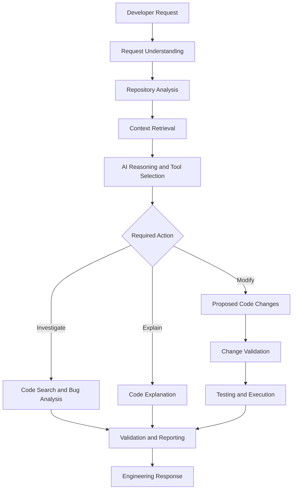
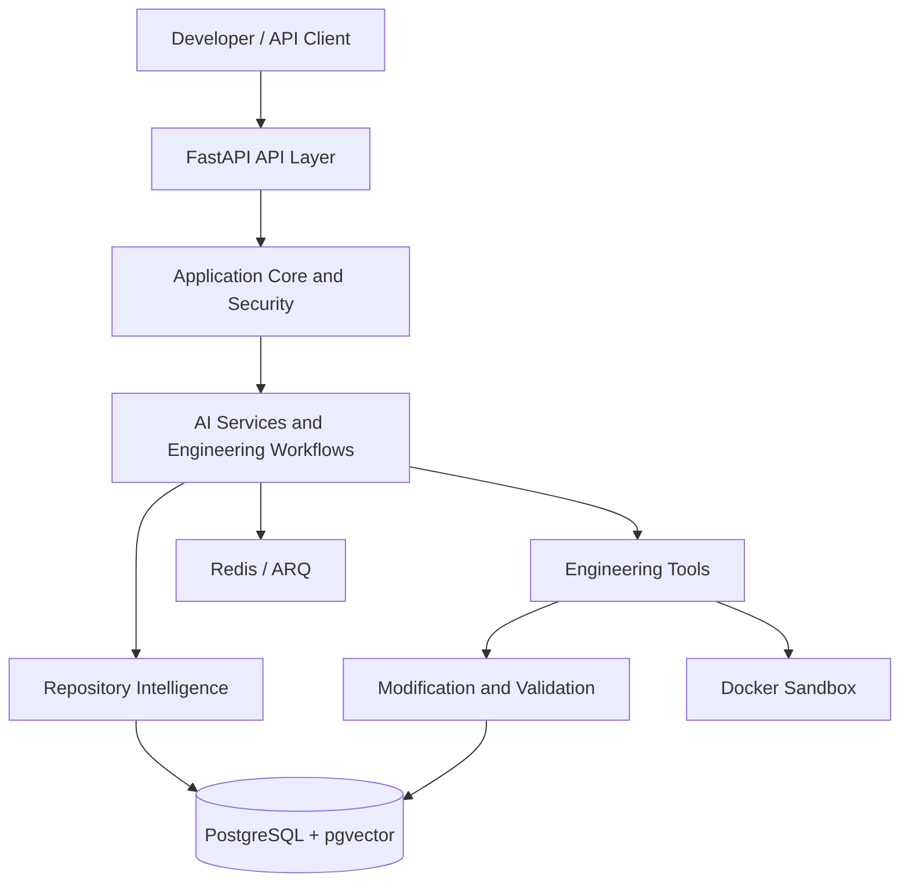

# 🚀 AI Software Engineering Agent Platform


**An AI-powered engineering workspace for understanding repositories, investigating bugs, and assisting with code changes.**


<p align="center">

  <strong>Repository Intelligence · AI-Assisted Development · Code Analysis · Validation</strong>

</p>


<p align="center">

  

  

  

  

  

  

</p>


---


## Overview


Modern software engineering involves more than writing code. Developers must understand unfamiliar repositories, trace failures across modules, investigate dependencies, evaluate potential fixes, and validate changes before they reach production.


The **AI Software Engineering Agent Platform** is a backend-focused project exploring how AI can support these engineering workflows through repository intelligence, contextual AI assistance, specialized tools, persistence, validation, and sandbox-oriented execution.


Rather than treating development as a simple question-and-answer interaction, the platform is designed around a structured workflow:


**Understand → Analyze → Retrieve Context → Investigate → Propose Changes → Validate → Report**


The objective is to build a foundation for an extensible AI engineering assistant that can work with real codebases and make software modification workflows easier to inspect and verify.


## Engineering Workflow





*Conceptual workflow. The availability of each execution path depends on the current implementation and configuration.*


## Core Capabilities


### 🔍 Repository Intelligence


Repository analysis components are intended to help the platform understand codebases before assisting with engineering tasks.


- Repository structure analysis

- Source-file scanning and classification

- Programming-language detection

- Code parsing and chunking

- Symbol and dependency inspection

- Code-focused context retrieval

- Repository metadata and search capabilities


### 🧠 AI-Assisted Engineering


Google Gemini is integrated as an AI provider for AI-assisted engineering workflows.


- Context-aware developer assistance

- Code explanation and comprehension

- Bug investigation support

- Repository-related questions

- Engineering tool services

- Conversation and message persistence


### 🛠️ Code Change Workflows


The project includes services intended to support structured code modification.


- Code modification requests

- Proposed change handling

- Modification validation

- Post-modification processing

- Failure-handling workflows

- Test-execution tooling


Actual approval, execution, rollback, and recovery behavior must be verified against the relevant implementations before being treated as production-ready features.


### 🧪 Validation and Execution


The platform includes validation and test-execution components, along with Docker-based sandbox components intended to support isolated code evaluation.


Sandbox security, resource restrictions, and isolation guarantees require dedicated testing.


### 🗄️ Backend and Data Infrastructure


- FastAPI REST API

- PostgreSQL persistence

- SQLAlchemy data models

- Alembic migration structure

- pgvector storage support

- Redis and ARQ background-job infrastructure

- Environment-based application configuration


## System Architecture





*Logical architecture overview; not every component necessarily participates in every request.*


### Architectural Principles


- **Separation of concerns:** API handlers, data models, and services have distinct responsibilities.

- **Context before generation:** Repository analysis helps supply relevant context to AI workflows.

- **Tool-oriented execution:** Engineering capabilities are organized around dedicated services and tools.

- **Validation-oriented changes:** Code changes should be inspected and tested before acceptance.

- **Extensibility:** Additional tools, retrieval strategies, and execution backends can be introduced over time.

- **Security-aware design:** Authentication, access controls, and execution isolation require continued verification.


## Technology Stack


| Layer | Technologies | Purpose |

|---|---|---|

| Backend API | Python, FastAPI | API endpoints and application services |

| AI integration | Google Gemini, `google-genai` | AI-assisted engineering |

| Relational database | PostgreSQL, SQLAlchemy | Persistent application data |

| Vector infrastructure | pgvector | Vector storage support |

| Database migrations | Alembic | Versioned schema management |

| Background processing | Redis, ARQ | Queue and worker infrastructure |

| Execution isolation | Docker | Sandbox-oriented execution |

| Testing | pytest | Automated testing |

| Configuration | Pydantic Settings, environment variables | Application configuration |


The current repository is backend-focused. A polished frontend, advanced multi-agent coordination, and additional integrations remain future development areas unless explicitly implemented and verified.


## Repository Structure


```text

AI Software Engineering Agent Platform/

├── backend/

│   ├── app/

│   │   ├── api/

│   │   │   └── v1/

│   │   ├── core/

│   │   ├── db/

│   │   ├── models/

│   │   ├── schemas/

│   │   └── services/

│   ├── alembic/

│   │   └── versions/

│   └── tests/

├── .env.example

├── .gitignore

├── alembic.ini

├── requirements.txt

└── README.md

```


*Simplified overview; individual files and directories may evolve during development.*


## Getting Started


### Prerequisites


Install and configure the services required for the workflows you intend to run:


- Python 3.13

- PostgreSQL 17 with pgvector

- Git

- Docker Desktop for sandbox functionality

- Redis for background-job functionality

- A Google Gemini API key for AI-powered features


### 1. Clone the repository


Replace the placeholder with your actual repository URL.


```bash

git clone <YOUR_GITHUB_REPOSITORY_URL>

cd "AI Software Engineering Agent Platform"

```


### 2. Create a virtual environment


Run these commands from the project root in Windows Command Prompt:


```cmd

python -m venv backend\\.venv

backend\\.venv\\Scripts\\activate

```


### 3. Install dependencies


```cmd

python -m pip install -r requirements.txt

```


### 4. Configure environment variables


Create a local environment file from the example:


```cmd

copy .env.example .env

```


Update the configuration with the database connection details and credentials required by your environment.


**Never commit real API keys, database passwords, or production secrets.**


### 5. Configure supporting services


Ensure PostgreSQL and the required extensions are configured. Start Redis and Docker Desktop if the selected workflows require them.


Review the environment and Alembic configurations before applying database migrations. Confirm that migrations target the intended database.


### 6. Run database migrations


Use the Alembic command appropriate for your actual configuration. For example, if the root `alembic.ini` is correctly configured for the backend migration environment:


```cmd

backend\\.venv\\Scripts\\python.exe -m alembic -c alembic.ini upgrade head

```


Do not run the migration until you have verified the configuration and database target.


### 7. Start the API server


From the project root:


```cmd

cd backend

..\\.venv\\Scripts\\python.exe -m uvicorn app.main:app --reload

```


The development server should be available at:


- **API base URL:** http://127.0.0.1:8000

- **Interactive API documentation:** http://127.0.0.1:8000/docs

- **Health endpoint:** http://127.0.0.1:8000/api/v1/health


A healthy response from the health endpoint does not, by itself, establish that every external service is operational.


## Testing and Quality


Run the automated test suite from the project root:


```cmd

backend\\.venv\\Scripts\\python.exe -m pytest backend\\tests -q

```


### Latest recorded verification snapshot


| Check | Last observed result |

|---|---|

| Automated tests | 192 passed |

| Pytest warnings | 0 |

| Package dependency check | No broken requirements found |


These are historical local results from development. Rerun the checks after code changes to confirm the current state. Passing tests do not guarantee production readiness or security.


## Security Considerations


AI-assisted code modification and execution require careful controls.


Important areas for continued implementation and review include:


- **Secrets management:** Keep credentials outside version control.

- **Authentication and authorization:** Verify user identity and access boundaries.

- **Repository isolation:** Restrict workspace access and validate file paths.

- **Execution isolation:** Run untrusted code in appropriately restricted environments.

- **Resource limits:** Apply CPU, memory, time, process, and filesystem restrictions.

- **Input validation:** Validate API requests, repository inputs, and modification requests.

- **AI output validation:** Treat generated code and model-produced tool arguments as untrusted.

- **Auditability:** Record useful change and execution outcomes without exposing secrets.


A Docker container alone is not a complete security boundary. Public deployment requires review of container privileges, networking, mounted filesystems, credentials, and host isolation.


## Engineering Roadmap


The roadmap tracks remaining development rather than implying every item is complete.


- [x] FastAPI application foundation and health endpoint

- [x] PostgreSQL persistence and Alembic migration structure

- [x] Repository analysis and code intelligence components

- [x] AI provider integration and engineering tool services

- [x] Code modification and validation service foundations

- [x] Automated test suite — 192 tests passed in the last recorded run

- [ ] Verify end-to-end repository-to-change workflows

- [ ] Strengthen sandbox isolation and security testing

- [ ] Add reproducible integration tests with PostgreSQL, Redis, and Docker

- [ ] Add structured execution traces and workflow observability

- [ ] Expand retrieval evaluation and code-change quality checks

- [ ] Develop a polished developer-facing interface

- [ ] Establish CI pipelines and automated security checks

- [ ] Prepare deployment documentation and operational monitoring


## Design Philosophy


This project explores the engineering systems needed to move beyond isolated AI code suggestions toward **context-aware, tool-driven, and validation-oriented software development**.


The focus is on the infrastructure around AI-assisted development: repository understanding, context retrieval, specialized tools, persistence, execution boundaries, validation, and clear feedback.


The long-term goal is an extensible platform that helps developers navigate unfamiliar codebases, investigate defects, and work through code changes with greater visibility and control.


## Contributing


Engineering feedback and contributions are welcome as the project develops.


1. Open an issue describing the problem or proposed improvement.

2. Keep changes focused and explain the reasoning behind them.

3. Add or update tests when behavior changes.

4. Run the test suite before submitting a pull request.

5. Document new configuration settings and security implications.


## License


No license has been specified yet. Usage and redistribution rights will depend on the license added to the repository.


---


<p align="center">

  <strong>Built to explore the engineering systems behind AI-assisted software development.</strong>

  <br />

  <sub>AI Software Engineering Agent Platform · Active Development</sub>

</p>
